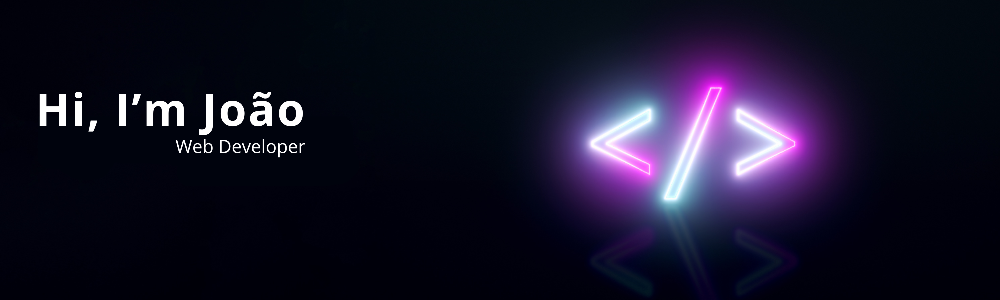

 

## Minha Stack

## Sobre mim

-  Olá! Meu nome é João Santana e sou Desenvolvedor FullStack.  
-  Meu objetivo atual é me tornar sênior e, no futuro, Tech Lead. 
-  Minha stack principal é HTML, CSS, JavaScript, TypeScript, React, NextJS, TailwindCSS, NodeJS e Styled-components. 
-  Sempre procuro ser uma pessoa educada e respeitosa, e adoro conhecer gente nova e compartilhar minha história. 
-  Quer conversar sobre tecnologia, games ou esportes? Me mande uma mensagem!

 

## Contato

